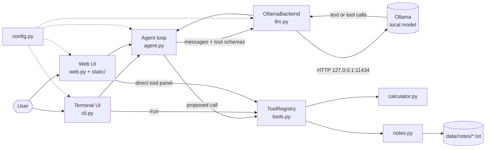
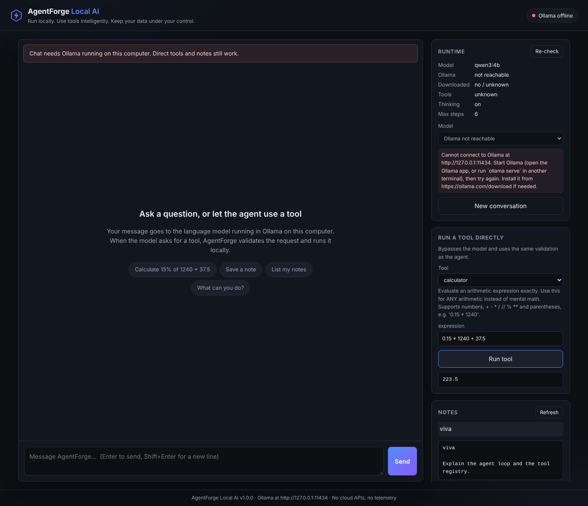
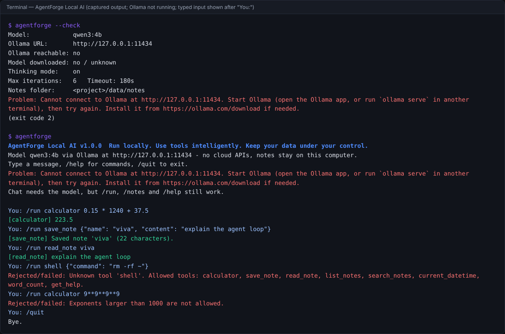
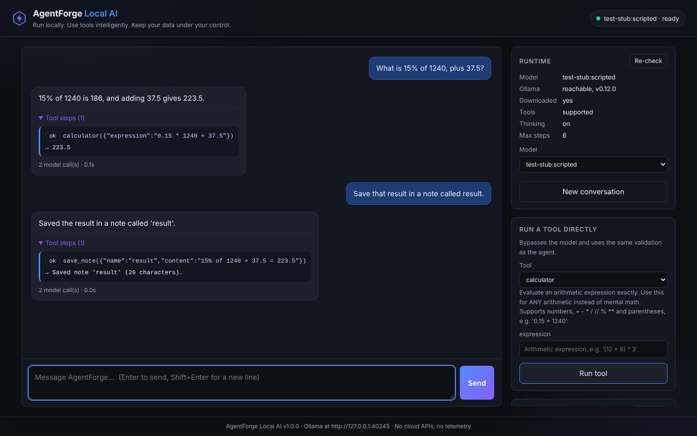

<div align="center">


# AgentForge Local AI

**A Privacy Focused Offline AI Agent Powered by Small Language Models**

*Run locally. Use tools intelligently. Keep your data under your control.*

[](LICENSE)
[](pyproject.toml)
[-8b5cf6.svg)](https://ollama.com)

[Project website](https://saqibahmadbhat.github.io/agentforge-local-ai/) ·
[Presentation (.pptx)](presentation/AgentForge_Local_AI_Presentation.pptx) ·
[Project report](docs/PROJECT_REPORT.md) ·
[User guide](docs/USER_GUIDE.md)

</div>

## Overview

AgentForge Local AI is an AI agent that runs a small language model (default `qwen3:4b`) on
your own computer through [Ollama](https://ollama.com). The model decides **whether** a tool
is needed. AgentForge **validates** the request and **executes** a deterministic Python tool:
calculator, notes, date/time, word count or help. The result goes back to the model, which
writes the final answer.

- There are no API keys, paid services, telemetry or cloud fallback.
- There are two interfaces: a terminal chat and a local web interface.

> **Status (29 October 2026):**
>
> - Automated tests, lint, type and security checks pass (see [Testing](#testing-and-results)).
> - An end-to-end run with a real language model has **not yet been verified**, because no model could be downloaded in the development environment.

**Academic context:** AgentForge Local AI was undertaken as part of the AI/ML EWB internship
course under the supervision of the EWB Courses programme.

## Contents

- [Problem statement](#problem-statement)
- [Objectives](#objectives)
- [Features](#features)
- [Architecture and data flow](#architecture-and-data-flow)
- [Screenshots](#screenshots)
- [Installation](#installation)
- [Running](#running)
- [Configuration](#configuration)
- [Troubleshooting](#troubleshooting)
- [Privacy and offline operation](#privacy-and-offline-operation)
- [Testing and results](#testing-and-results)
- [Supported environments and limitations](#supported-environments-and-limitations)
- [Project structure](#project-structure)
- [Licence, attribution and citation](#licence-attribution-and-citation)
- [Maintainer](#maintainer)

## Problem statement

Most AI-agent demonstrations depend on cloud APIs. They:

- cost money;
- need a network connection;
- send prompts and documents to third parties;
- hide the agent loop inside frameworks.

Small open-weight language models now run on laptops and support structured tool calling.
AgentForge uses them to build an agent whose entire pipeline runs on one computer and can be
inspected and tested. That pipeline is the model server, the agent loop and the tools.

## Objectives

1. **Local inference only:** no paid API and no cloud fallback.
2. **Safe tool execution:** the model proposes; validated, allow-listed Python code executes.
3. **Bounded execution:** limits on iterations, repeated calls and sizes.
4. **Explicit failure handling:** for an unavailable service, a missing model, timeouts, malformed replies and storage errors.
5. **Usable interfaces:** a terminal and a local web UI, with visible tool traces and runtime status.
6. **Verifiable evidence:** tests that need no model, and documentation that matches the code.

## Features

| Area | Implementation |
|---|---|
| Local inference | Connects to Ollama at `http://127.0.0.1:11434` with a timeout. `--check` reports the server version, whether the model is downloaded, and its tool/thinking support. In the web UI you can choose among locally downloaded models |
| Agent loop | Model call → validated tool calls → observations → answer. Limits on iterations (6), tool calls per step (4) and repeated identical calls (2), plus input, output and tool-result size limits |
| Tools | `calculator` (AST-based, never `eval`), `save_note`, `read_note`, `list_notes`, `search_notes`, `current_datetime`, `word_count`, `get_help`. There is **no** code or shell execution tool |
| Validation | Unknown tools are rejected. Argument names, types and lengths are checked before anything runs. Errors return to the model as text so it can correct itself |
| Notes | Plain-text files in `data/notes/`. Safe names, so no path traversal. Never silently overwritten. Clear errors for disk or permission failures |
| Interfaces | Terminal chat with `/run`, `/notes`, `/status`, `/reset` and more. Local web UI with conversation history, a tool-step trace, runtime status, model selection, a direct tool panel and notes |
| Error handling | Typed errors with hints for every failure listed under objective 4. Direct tools keep working without the model |

## Architecture and data flow



**One request:**

1. Reject empty or over-long input.
2. Send the conversation and the JSON schemas of the 8 tools to the local model.
3. If the reply contains no tool call, it is the final answer.
4. Otherwise validate each call against the allow-list. Exact repeats are not executed again.
5. Run the tool and return its result to the model.
6. Stop at the final answer, after 6 model calls, or when the model keeps repeating itself.

Every network request goes only to the configured Ollama URL. The default is loopback.

Details: [docs/ARCHITECTURE.md](docs/ARCHITECTURE.md).

## Screenshots

All three images were captured from the running application. No language model was
available while they were taken, and each caption says exactly what is shown.

**Web interface, Ollama not running (real state).** Chat is disabled with a clear message.
The calculator and a saved note were used through the direct tool panel.



**Terminal interface (captured output, Ollama not running).** Typed commands are shown
after `You:`.



**How the web interface lays out a conversation with tool steps.** The replies in this image
come from the **scripted stub model server used by the automated tests** (`test-stub:scripted`),
so they are **not real model output**. The tool results were computed by AgentForge's real tools.



## Installation

**Prerequisites:**

- macOS or Linux (Windows is untested);
- Python 3.10 or newer;
- Git;
- [Ollama](https://ollama.com/download) 0.9.0 or newer;
- about 4 GB of free RAM for `qwen3:4b` on CPU. A GPU is optional.

```bash
git clone https://github.com/SaqibAhmadBhat/agentforge-local-ai.git
cd agentforge-local-ai
ollama pull qwen3:4b                    # model setup: about 2.5 GB, once, needs internet
python3 -m venv .venv
.venv/bin/pip install -e ".[dev]"       # or: uv sync --extra dev
```

The full guide covers uv, Windows notes, other models and uninstalling:
[docs/INSTALLATION.md](docs/INSTALLATION.md).

> If your folder's path contains `:` (macOS shows a `/` in a Finder name as `:`), use the
> `.venv/bin/python -m agentforge` commands below, because `uv run` and venv activation break
> on that path.

## Running

Start Ollama first, either by opening the Ollama app or by running `ollama serve`. Then run:

```bash
.venv/bin/python -m agentforge --check     # Ollama, model and tool support
.venv/bin/python -m agentforge             # terminal chat (/help lists commands)
.venv/bin/python -m agentforge --web       # web UI at http://127.0.0.1:8765/
.venv/bin/python -m agentforge "What is 15% of 1240?"   # one question, then exit
```

To stop: type `/quit` in the terminal chat, and press Ctrl-C to stop the web server.
[docs/USER_GUIDE.md](docs/USER_GUIDE.md) explains every command, the web interface and a
demonstration script.

## Configuration

Copy `.env.example` to `.env`. Real environment variables override the file.

| Variable | Default | Meaning |
|---|---|---|
| `AGENTFORGE_MODEL` | `qwen3:4b` | Ollama model (must support tools). Can also be set with `--model` |
| `AGENTFORGE_OLLAMA_URL` | `http://127.0.0.1:11434` | Ollama server. Loopback only unless the next setting is `true` |
| `AGENTFORGE_ALLOW_REMOTE_OLLAMA` | `false` | Allow a server on another machine. Your prompts would leave this computer |
| `AGENTFORGE_TIMEOUT_SECONDS` | `180` | Maximum wait for one model reply |
| `AGENTFORGE_MAX_ITERATIONS` | `6` | Model calls per request |
| `AGENTFORGE_THINK` | `true` | Thinking mode. Use `false` for speed, or for models without it |
| `AGENTFORGE_NUM_GPU` | *(blank)* | `0` forces CPU-only inference |
| `AGENTFORGE_DATA_DIR` | `data` | Notes folder (`data/notes`) |
| `AGENTFORGE_WEB_PORT` | `8765` | Web UI port (always bound to 127.0.0.1) |

All settings, including the size limits, are documented in [`.env.example`](.env.example).

## Troubleshooting

| Message | Fix |
|---|---|
| `Cannot connect to Ollama at ...` | Start Ollama, then check with `ollama list` |
| `The model '...' is not available` | `ollama pull <model>` |
| `does not support tool calling` / `thinking` | Use a tool-capable model / set `AGENTFORGE_THINK=false` |
| `did not answer within 180 seconds` | Retry (the first load is slow), set `AGENTFORGE_THINK=false`, or raise the timeout |
| `Could not start the web interface on 127.0.0.1:8765` | Run `--web --port 8766` |

## Privacy and offline operation

- **Inference stays local.** Model traffic goes only to the configured Ollama URL, which must be loopback unless you explicitly opt in. A test records every socket connection during a full agent run and fails on any non-loopback address.
- **No cloud path:**
  - Ollama cloud models (`*-cloud`) are refused;
  - proxy variables and HTTP redirects are ignored;
  - if Ollama is down, AgentForge reports it and stops.
- **No code execution.** There is no tool that runs code or shell commands. The calculator never uses `eval`.
- **Web UI hardening:**
  - binds to 127.0.0.1 only;
  - rejects foreign `Host` headers and cross-site `Origin`s;
  - accepts JSON-only bodies up to 64 KB;
  - sends a strict Content-Security-Policy;
  - shows model output as text, never as HTML.
- **Local data:**
  - notes are plain text in `data/notes/`, not encrypted, and ignored by Git;
  - the conversation is kept in memory only;
  - logs never contain prompts or notes, and there is no telemetry.
- **What still needs the internet:**
  - installing packages and Ollama;
  - `ollama pull`;
  - updates.

  Ollama itself may contact the internet for its own purposes, such as update checks.

## Testing and results

```bash
.venv/bin/python -m pytest                 # 214 core tests, no model needed
```

| Check (29 October 2026) | Result |
|---|---|
| Core test suite, Python 3.10.12 and 3.12.15 (Linux) | **214 passed**. Skipped: 3 live tests, plus the browser tests where Playwright is not installed |
| Full suite including 5 Playwright browser tests, Python 3.13 (Linux) | **219 passed, 3 skipped** (live tests) |
| `ruff check`, `ruff format --check`, `mypy agentforge` | Clean |
| `bandit -r agentforge` | No issues identified |
| `pip-audit` | No known vulnerabilities in the installed dependencies |
| Real-model end-to-end and live tests | **Not yet performed** |

[docs/TESTING.md](docs/TESTING.md) explains how the tests replace the model (a scripted fake
and a stub Ollama server), lists every test file, and records the manual checks.

## Supported environments and limitations

- **Tested:**
  - Linux, Python 3.10, 3.12 and 3.13;
  - Ollama's HTTP API, emulated by a stub in the tests.
- **Expected to work, but not tested:** macOS, since nothing in the code is Linux-specific.
- **Not tested:** Windows.
- **Model behaviour is not yet verified with a real model.** Small models can choose the wrong tool or answer poorly. Validation prevents unsafe *actions*, not wrong *words*.
- **Speed.** CPU inference can be slow, especially with thinking mode on and on the first request.
- **Tools.** The calculator does arithmetic only. Notes cannot be edited or deleted through the agent.
- **Scope.** Single user, notes not encrypted, and cloud models detected by name (`*-cloud`).

## Project structure

```text
agentforge/        application package: agent loop, Ollama backend, tools, CLI, web server
  static/          web UI (HTML, CSS, JS and logo; no external assets)
tests/             unit, integration, browser and optional live tests
docs/              architecture, installation, user guide, testing, report, viva guide,
                   contributions, third-party notices, screenshots
presentation/      editable 12-slide PowerPoint and PDF preview
site/              project website (published to GitHub Pages from the gh-pages branch)
CHANGELOG.md  CITATION.cff  LICENSE  pyproject.toml  requirements*.txt  uv.lock  .env.example
```

## Licence, attribution and citation

- **Licence:** [MIT](LICENSE).
- **Upstream source:** AgentForge Local AI builds on the MIT-licensed project [Fully-Offline-AI-agent-using-SLM](https://github.com/BhargavaKandala/Fully-Offline-AI-agent-using-SLM) by Bhargava Kandala, from commit `ef2d5f5`. Its copyright and permission notice are retained in `LICENSE`.
- **What changed:** inherited, modified and new components are listed in [docs/CONTRIBUTIONS.md](docs/CONTRIBUTIONS.md).
- **Third-party licences:** dependency and model licences are in [docs/THIRD_PARTY_NOTICES.md](docs/THIRD_PARTY_NOTICES.md). Model weights are not included; `qwen3:4b` is downloaded through Ollama under its own licence (Apache-2.0).
- **Citation:** use [CITATION.cff](CITATION.cff); GitHub's "Cite this repository" button reads it.

## Maintainer

**Saqib Ahmad Bhat**, Student Developer
B.E. Computer Science and Engineering, Government College of Engineering, Tirunelveli, Tamil Nadu, India

[Email](mailto:saqibahmadbhat885@gmail.com) ·
[LinkedIn](https://www.linkedin.com/in/saqibahmadbhat/) ·
[ORCID 0009-0003-9248-6174](https://orcid.org/0009-0003-9248-6174) ·
[GitHub](https://github.com/SaqibAhmadBhat) ·
[Project website](https://saqibahmadbhat.github.io/agentforge-local-ai/)

Acknowledgements:

- the EWB Courses programme;
- Bhargava Kandala, for the upstream project;
- the Ollama project and the Qwen team, for open local inference tools and models.

To update the website after editing `site/`, commit to `main`, then run
`git subtree push --prefix site origin gh-pages`.
