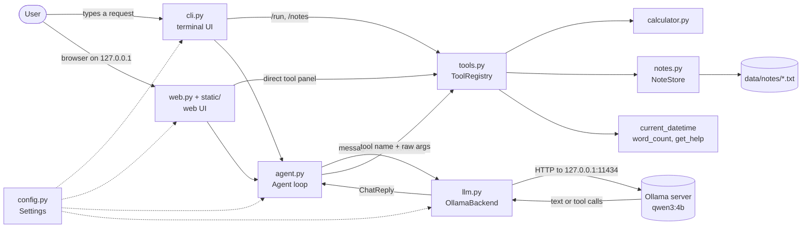
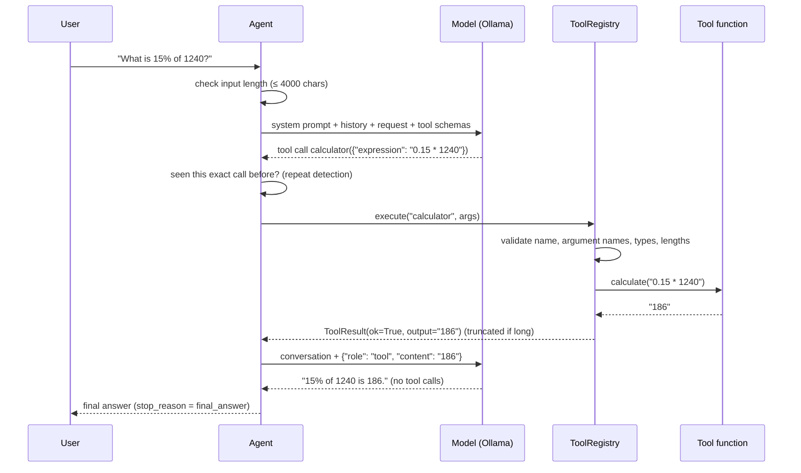

# AgentForge Local AI: Architecture

This document describes how the code in `agentforge/` is organised and how one request
flows through it. Everything here matches the implementation in this repository.

## 1. Components

| Module | Responsibility | Key names |
|---|---|---|
| `config.py` | Reads `AGENTFORGE_*` variables and `.env`, validates them, and applies the offline guards (loopback-only URL, no cloud models) | `Settings`, `load_settings`, `is_loopback_url`, `is_cloud_model` |
| `llm.py` | The only module that talks to the model server. Converts the SDK's replies and exceptions into AgentForge types. Runs the health check and lists the locally downloaded models | `ChatBackend` (interface), `OllamaBackend`, `ChatReply`, `ToolCallRequest`, `ServiceStatus` |
| `agent.py` | The agent loop, its limits and the system prompt | `Agent.run`, `AgentResult`, `AgentStep`, `SYSTEM_PROMPT` |
| `tools.py` | The allow-list of tools, their JSON schemas, argument validation, safe execution and output truncation | `Tool`, `Parameter`, `ToolRegistry`, `build_default_registry` |
| `calculator.py` | Arithmetic over a restricted Python syntax tree, with size limits | `evaluate`, `calculate`, `CalculatorError` |
| `notes.py` | One text file per note, safe names, no overwrite, search, clear storage-failure errors | `NoteStore`, `note_key`, `NoteError` |
| `cli.py` | Command-line interface: chat loop, `/commands`, one-shot mode, `--check`, `--web`, exit codes | `main`, `AgentForgeCLI` |
| `web.py`, `static/` | Local web interface: standard-library HTTP server on 127.0.0.1, JSON API, security checks; plain HTML, CSS and JavaScript front end with no external assets | `WebApp`, `create_server`, `serve` |
| `errors.py` | Exception hierarchy. Each error carries a user-facing `hint` | `LLMUnavailableError`, `ToolValidationError`, ... |

The agent depends on the `ChatBackend` interface rather than on Ollama directly.
That is why the tests can swap in a scripted fake model.

## 2. One request, step by step

This is the loop in `Agent.run`:

1. **Receive** the request. Reject it if it is empty or longer than `max_input_chars`.
2. **Ask the model** with the system prompt, up to `history_turns` earlier Q/A pairs, the request, and the JSON schemas of all tools.
3. **Decide:** if the reply has no tool calls, its text is the final answer.
4. **Select / validate:** for each proposed call (at most `max_tool_calls_per_step`), the registry checks the name against the allow-list. It also checks argument names, required arguments, types (no `bool` in place of `int`) and string lengths.
5. **Execute** the Python function. Expected failures (division by zero, missing note) and unexpected crashes are both turned into text. A crash's details are not logged, because they may contain note text.
6. **Observe:** each result is appended as a `tool` message, truncated to `max_tool_result_chars`, and the model is asked again.
7. **Stop** on a final answer; after `max_iterations` model calls (`iteration_limit`); or when the model asks for the identical (tool, arguments) pair twice more (`repeated_tool_calls`). Repeated calls are **not** executed again; the model is reminded of the earlier result.

## 3. How tool calling works

AgentForge uses **native tool calling** through Ollama's `/api/chat`:

- `ToolRegistry.schemas()` produces one JSON schema per tool, sent in the `tools` field.
- A tool-capable model such as `qwen3:4b` answers with structured `tool_calls` (name plus a JSON object of arguments) instead of free text. Ollama parses the model's output into that structure.
- `agentforge --check` reads the model's advertised `capabilities` from `/api/show` and reports a problem if `tools` is missing.

Small models do not always use tools correctly. They may skip a tool, pick the wrong one,
pass wrong argument names or repeat a call. AgentForge does not pretend otherwise. It
**validates every proposed call**, returns precise error messages so the model can correct
itself, and bounds the loop. For demonstrations that must be deterministic, `/run TOOL ARGS`
calls the same registry directly, without the model.

## 4. Web interface API

`agentforge --web` serves the page and a small JSON API on `127.0.0.1` (default port 8765).
The browser code in `static/app.js` uses only these endpoints:

| Method and path | Purpose |
|---|---|
| `GET /` and `GET /static/{index.html, app.css, app.js, logo.svg}` | The page (served from a fixed allow-list of files) |
| `GET /api/status` | Settings summary and the Ollama health check |
| `GET /api/tools` | Tool names, descriptions and parameters (builds the direct tool form) |
| `GET /api/notes` | Note names |
| `GET /api/models` | Locally downloaded models (cloud models excluded) |
| `POST /api/chat {message}` | Runs `Agent.run`. Returns the answer, stop reason, iterations and tool steps. Errors: 400 bad input, 409 busy, 503 model service problem (with a hint) |
| `POST /api/tool {tool, arguments}` | Runs a tool directly through `ToolRegistry.execute` (no model) |
| `POST /api/model {model}` | Switches to another downloaded model and starts a new conversation |
| `POST /api/reset` | Clears the conversation |

One request reaches the model at a time, enforced by a lock. The server keeps one
conversation, because it is meant for the single user at this computer.

## 5. Safety and privacy design

| Risk | Mitigation (where) |
|---|---|
| Model-generated code being executed | No code/shell tools exist. The calculator walks an AST allow-list and never calls `eval`. A test scans the package source for `eval`, `exec`, `subprocess` and `os.system`/`os.popen` (`test_offline.py`) |
| Denial of service through arithmetic (`9**9**9**9`) | Expression length ≤ 200, exponent ≤ 1000, every intermediate value ≤ 1e50 (`calculator.py`) |
| Path traversal through note names | Names are reduced to `[a-z0-9-]`, then resolved paths are checked to be inside `data/notes/`, which also blocks symlink escapes (`notes.py`) |
| Silent data loss | Notes are created with exclusive mode `"x"`, so they are never overwritten (`notes.py`) |
| Unknown tools or malformed arguments | Strict allow-list and validation before execution (`tools.py`) |
| Infinite loops, unbounded context | Iteration limit, per-step tool-call limit, repeat detection, input, output and tool-result size limits (`agent.py`, `config.py`) |
| Prompts leaving the computer | Loopback-only URL unless explicitly allowed. `*-cloud` models refused. `trust_env=False` ignores proxy variables. Redirects not followed. No cloud fallback (`config.py`, `llm.py`) |
| Secrets or notes in logs | No API keys exist. Logs record only exception *types* from tools, never arguments or note text. Default log level is WARNING |
| Telemetry | None. AgentForge makes no network calls other than to the configured Ollama URL |
| Web UI reached by other machines or websites | Bound to 127.0.0.1. Requests with a foreign `Host` header are refused (DNS rebinding), and so are POSTs with a foreign `Origin` (cross-site requests). JSON-only bodies up to 64 KB. No CORS headers. Strict Content-Security-Policy (no inline or external scripts). Static files served from an allow-list (`web.py`) |
| Model output injected into the page | The browser inserts all server text with `textContent`, never `innerHTML`. A browser test checks that an `` answer is shown as text (`test_ui_browser.py`) |
| Storage failures (permissions, full disk) | Reported as clear tool errors. A half-written note is removed (`notes.py`) |

## 6. Data and state

- **Notes:** `data/notes/<name>.txt`, UTF-8, ignored by Git.
- **Conversation history:** in memory only, the last `history_turns` question/answer pairs, cleared by `/reset` or on exit. Tool messages are not kept in history.
- **Configuration:** environment variables override `.env`, which overrides the defaults in `Settings`.

## 7. Differences from the upstream design

The upstream project ([Fully-Offline-AI-agent-using-SLM, commit `ef2d5f5`](https://github.com/BhargavaKandala/Fully-Offline-AI-agent-using-SLM/tree/ef2d5f5)) already had the core idea: a
hand-written ReAct loop, native Ollama tool calling and an AST calculator. AgentForge keeps
that idea and restructures it. Main changes:

- an explicit registry with validation, instead of `func(**arguments)`;
- typed errors and a health check, instead of tracebacks;
- configuration through environment variables, instead of editing Python constants;
- network guards;
- a bounded calculator;
- notes that are never overwritten and can be searched;
- repeat detection and size limits;
- a test suite;
- a local web interface.

See [CONTRIBUTIONS.md](CONTRIBUTIONS.md) for the full list.
